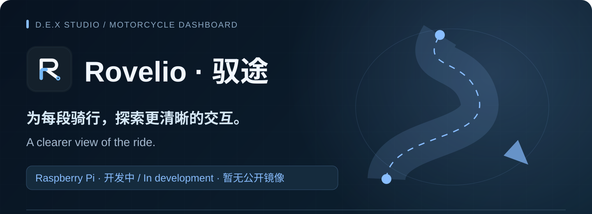
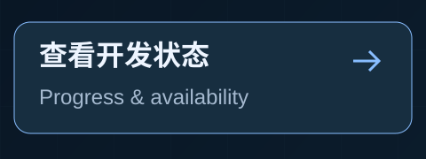
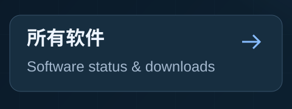
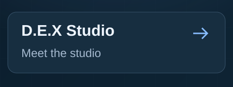
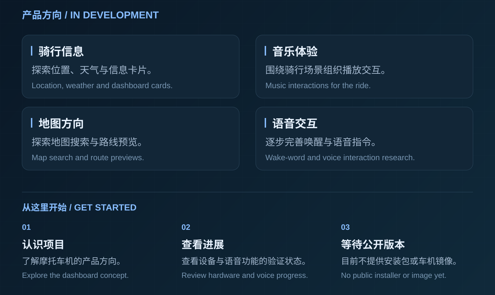

文字版介绍与常用链接 / Accessible overview & links

Raspberry Pi · 开发中 / In development · 暂无公开镜像

- **骑行信息**：探索位置、天气与信息卡片。 Location, weather and dashboard cards.
- **音乐体验**：围绕骑行场景组织播放交互。 Music interactions for the ride.
- **地图方向**：探索地图搜索与路线预览。 Map search and route previews.
- **语音交互**：逐步完善唤醒与语音指令。 Wake-word and voice interaction research.

- [查看开发状态 / Progress & availability](https://github.com/dex-ovo-studio/DEX-Rider/blob/main/STATUS.md)
- [所有软件 / Software status & downloads](https://github.com/dex-ovo-studio/DEX-Studio-Software-Status)
- [D.E.X Studio / Meet the studio](https://github.com/dex-ovo-studio)

公开发行时间尚未确定；功能完成情况请以[开发状态](https://github.com/dex-ovo-studio/DEX-Rider/blob/main/STATUS.md)为准。  
No public release date is set. See the development status for completed and pending work.
