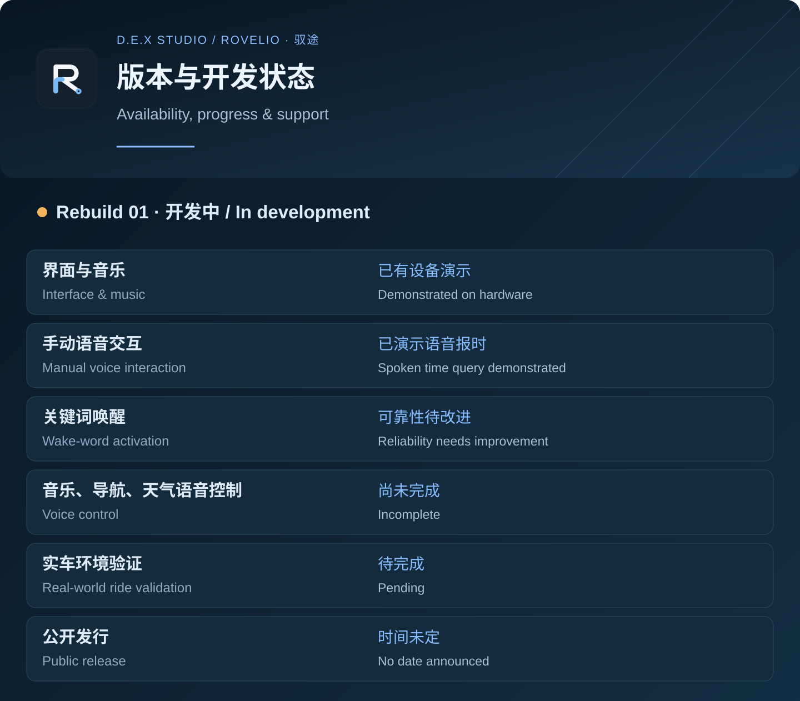

文字版状态 / Accessible status

[← Rovelio · 驭途](https://github.com/dex-ovo-studio/DEX-Rider) · [所有软件 / All software](https://github.com/dex-ovo-studio/DEX-Studio-Software-Status)

**🟠 开发中 · 暂无公开镜像 / In development · No public image**  
Rebuild 01 · 开发原型 / Development prototype

| 内容 / Area | 状态 / Status |
| :--- | :--- |
| 界面与音乐 / Interface & music | 已有设备演示 / Demonstrated on hardware |
| 手动语音交互 / Manual voice interaction | 已演示语音报时 / Spoken time query demonstrated |
| 关键词唤醒 / Wake-word activation | 可靠性待改进 / Reliability needs improvement |
| 音乐、导航、天气语音控制 / Voice control | 尚未完成 / Incomplete |
| 实车环境验证 / Real-world ride validation | 待完成 / Pending |
| 公开发行 / Public release | 时间未定 / No date announced |

公开发行时间尚未确定。上表仅表示已记录的开发进展，不代表完整功能已可公开使用。  
No public release date is set. Recorded progress does not mean the full product is ready for public use.

进度记录 / Progress as of 2026-09-06

